<div align="center">

# Data Mining Application

**An end-to-end, interactive data mining workbench — clustering and classification algorithms implemented from scratch, powered by Streamlit.**

[](https://www.python.org/)
[](https://streamlit.io/)
[](https://www.docker.com/)
[](LICENSE)
[](#-algorithms-implemented-from-scratch)

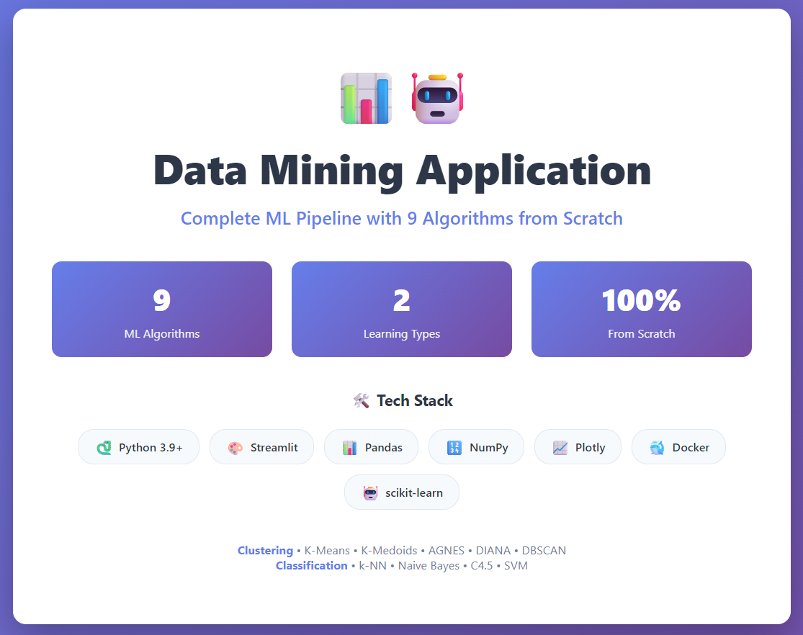

</div>

---

## 📌 Overview

This project is a complete **data mining pipeline in a single web app**. It walks you from raw CSV to trained model through a guided, phase-by-phase workflow: load → clean → explore → normalize → cluster → classify.

Rather than calling a black-box library, every core algorithm (K-Means, K-Medoids, AGNES, DIANA, DBSCAN, k-NN, Naive Bayes, C4.5, and SVM) is **implemented from scratch** with NumPy and Pandas. The UI lets you tune parameters, run algorithms side by side, compare them with standard evaluation metrics, and get an automatic "best algorithm" recommendation.

> Built as a Data Mining course project with strict academic grounding — every formula follows the course material.

---

## ✨ Highlights

- 🧩 **9 algorithms from scratch** — 5 clustering + 4 classification, no `sklearn` estimators.
- 🎛️ **Interactive configuration** — tune `k`, linkage, `eps`/`MinPts`, kernels, `C`, and more.
- ⚖️ **Compare mode** — run all algorithms at once and rank them with a composite score.
- 📊 **Rich visualizations** — 2D/3D cluster plots, elbow curves, dendrograms, confusion-matrix heatmaps, and more.
- 🧪 **Full preprocessing toolkit** — duplicates, missing values, outliers, typing, and min–max / z-score normalization.
- 🐳 **One-command startup** with Docker or Docker Compose.

---

## 🖼️ Screenshots

<table>
  <tr>
    <td width="50%">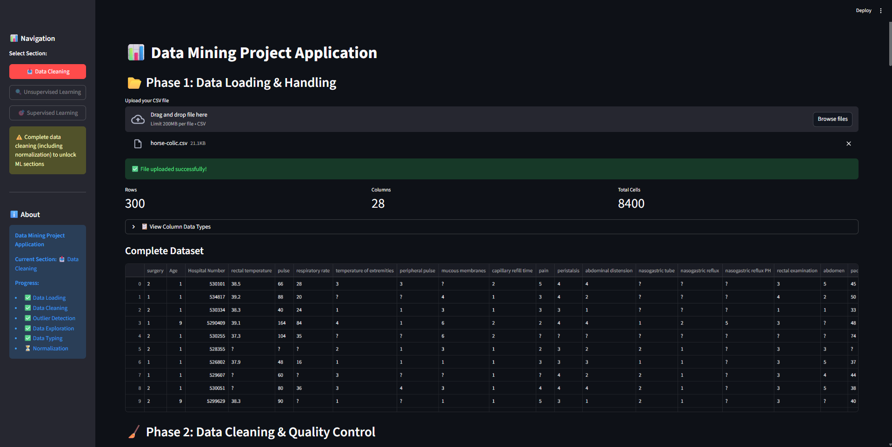</td>
    <td width="50%">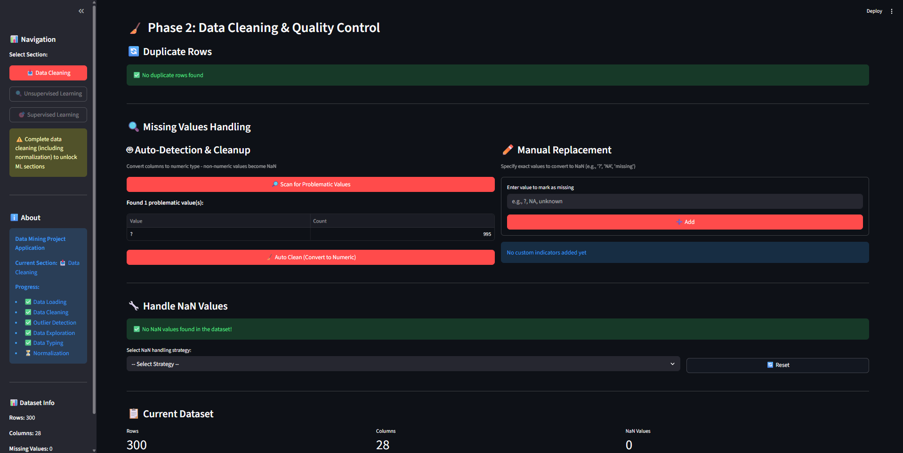</td>
  </tr>
  <tr>
    <td width="50%">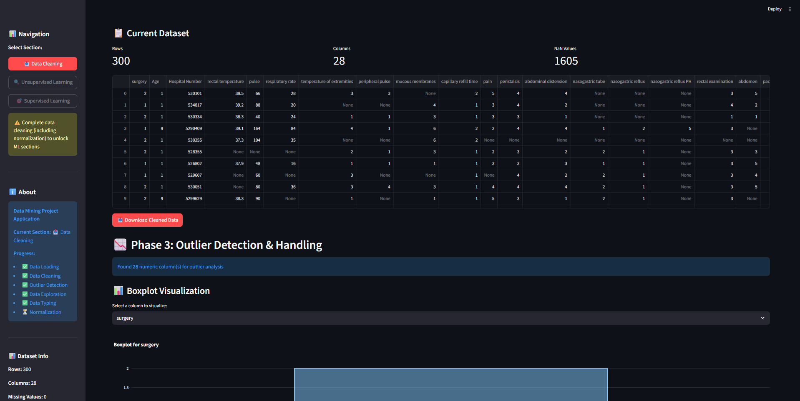</td>
    <td width="50%">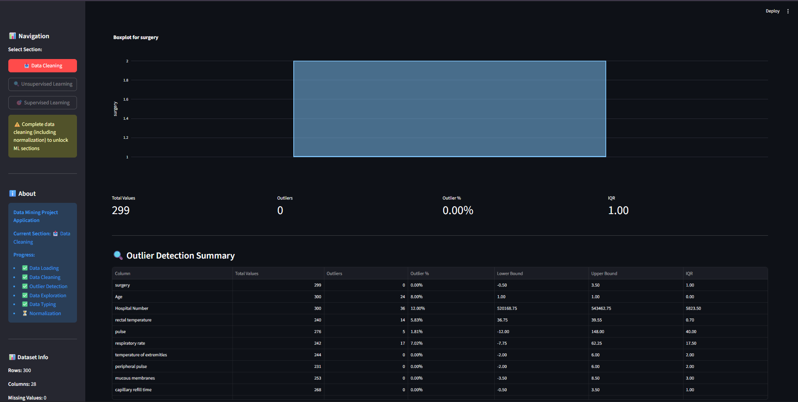</td>
  </tr>
  <tr>
    <td width="50%">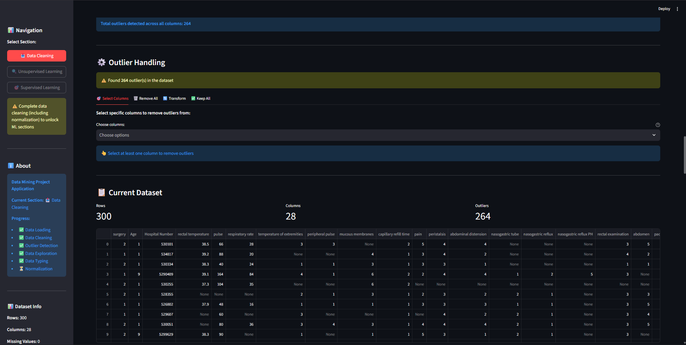</td>
    <td width="50%">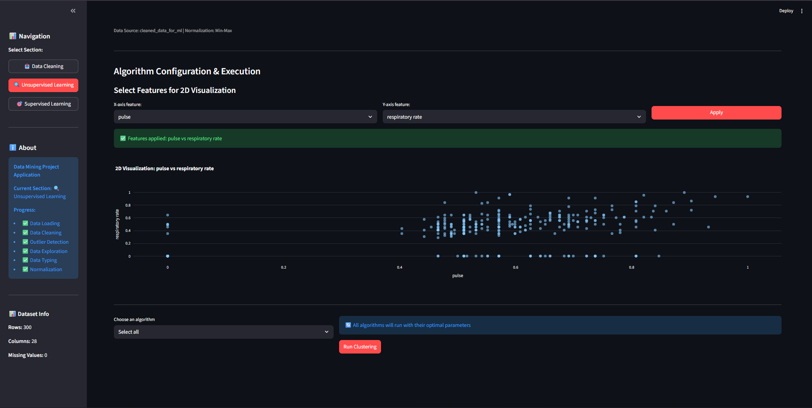</td>
  </tr>
  <tr>
    <td width="50%">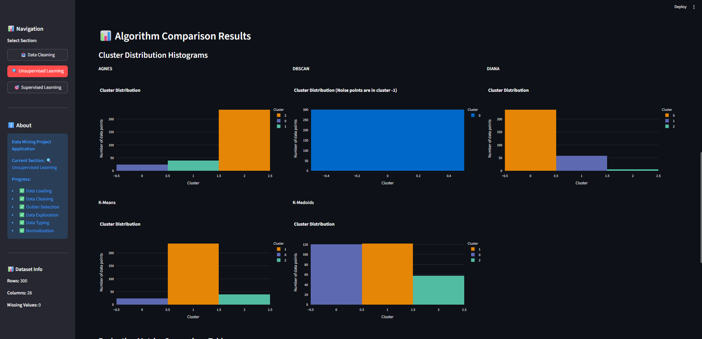</td>
    <td width="50%">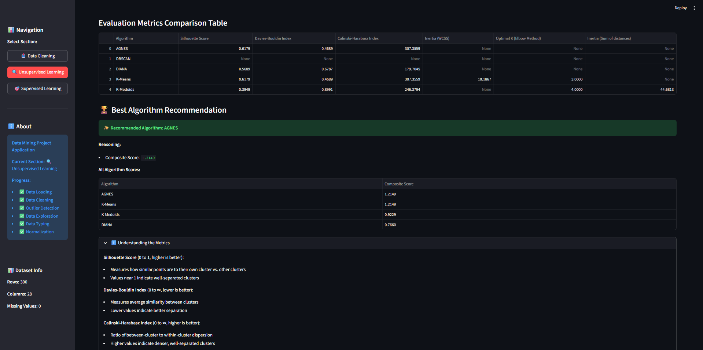</td>
  </tr>
  <tr>
    <td width="50%">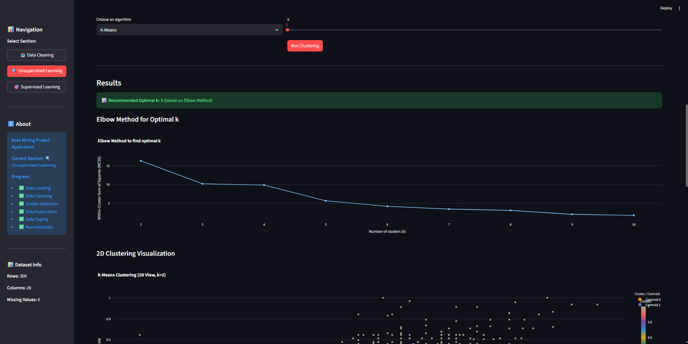</td>
    <td width="50%">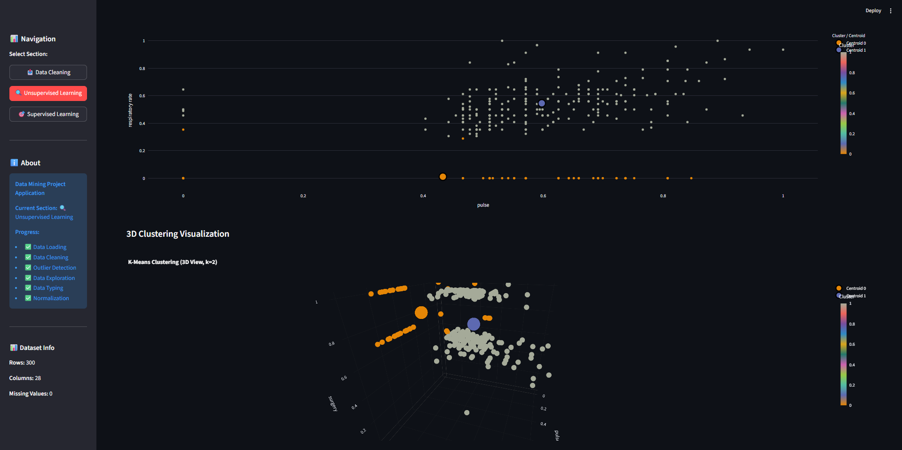</td>
  </tr>
  <tr>
    <td width="50%">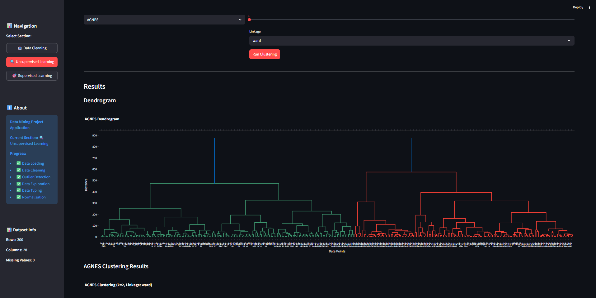</td>
    <td width="50%">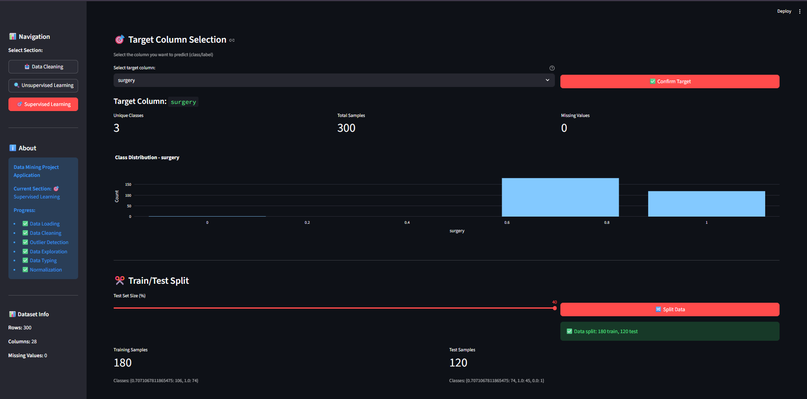</td>
  </tr>
  <tr>
    <td width="50%">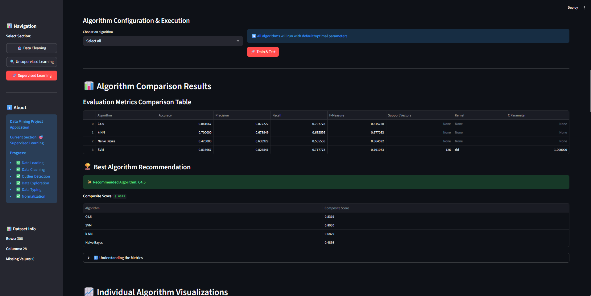</td>
    <td width="50%">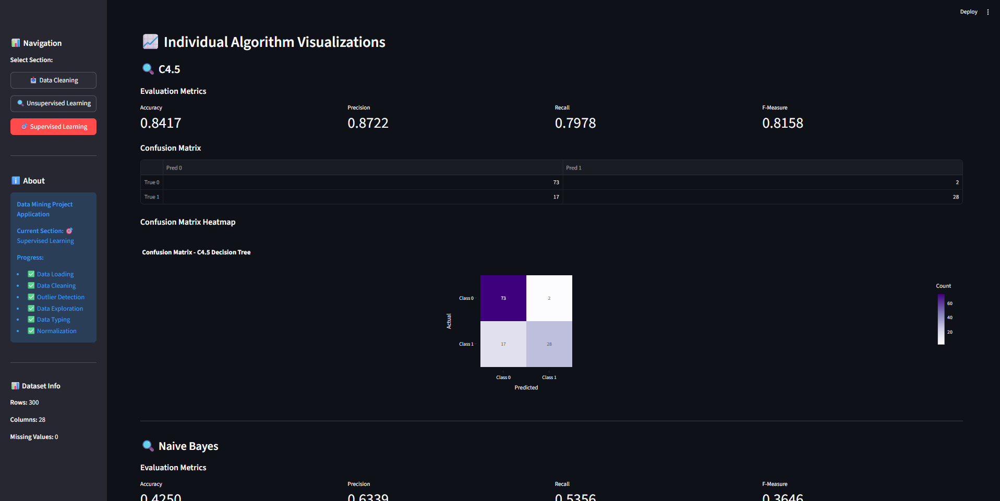</td>
  </tr>
  <tr>
    <td width="50%">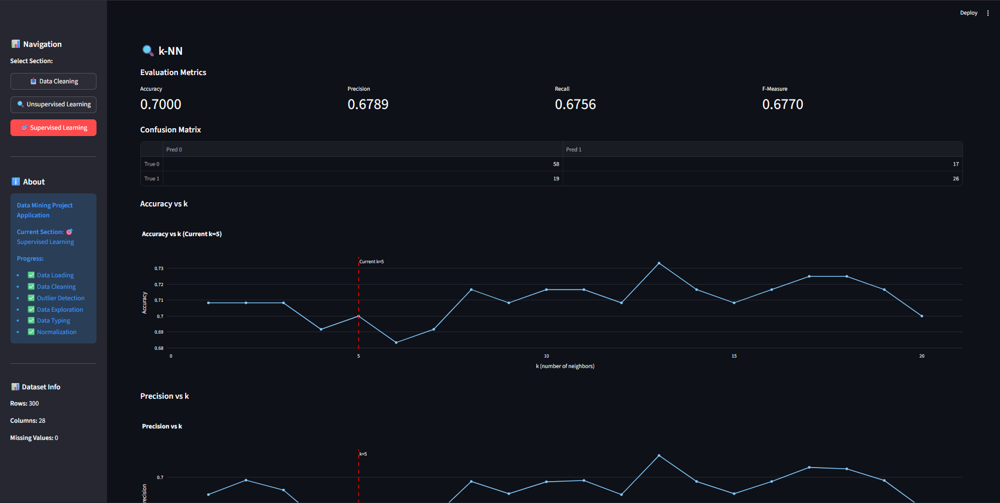</td>
    <td width="50%"></td>
  </tr>
</table>

---

## 🚀 Quick Start

### Prerequisites

- **Docker** (recommended), or
- **Python 3.9+**

### Option 1 — Docker (recommended)

```bash
git clone https://github.com/RamyRxr/DM-Project.git
cd DM-Project
docker build -t data-mining-app .
docker run -p 8501:8501 data-mining-app
```

Open **http://localhost:8501**.

### Option 2 — Docker Compose

```bash
git clone https://github.com/RamyRxr/DM-Project.git
cd DM-Project
docker compose up --build
```

### Option 3 — Run locally with Python

```bash
git clone https://github.com/RamyRxr/DM-Project.git
cd DM-Project
python -m venv .venv && source .venv/bin/activate   # Windows: .venv\Scripts\activate
pip install -r requirements.txt
streamlit run app.py
```

The app opens at **http://localhost:8501**.

---

## 🧭 How It Works

The app is organized into a guided workflow. **Data Cleaning** (Phases 1–6) must be completed before the machine-learning sections unlock.

### 🧹 Data Cleaning & Preparation (Phases 1–6)

| Phase | What it does |
| :---: | --- |
| **1 · Data Loading** | Upload a CSV, inspect dimensions, columns, and dtypes. |
| **2 · Cleaning & Quality** | Detect/remove duplicates; handle missing values (auto-clean, custom indicators, drop, fill 0/mean/median, forward/backward fill); drop columns. |
| **3 · Outlier Detection** | Per-column boxplots, outlier summary, and choose to remove, cap, or keep outliers. |
| **4 · Exploration** | Descriptive statistics (min, max, mean, median, mode, Q1, Q3) and scatter plots. |
| **5 · Data Typing** | Detect float columns that represent integers and safely convert them. |
| **6 · Normalization** | Min–Max scaling, Z-score standardization, or skip. Numeric columns only. |

### 🔍 Unsupervised Learning — Clustering

- **Feature selection** for 2D/3D visualization with a live preview.
- **Single run** with algorithm-specific parameters, or **Select all** to compare every algorithm.
- Visuals: 2D & 3D cluster scatter plots, centroid/medoid markers, elbow curves with optimal-`k` detection, cluster histograms, and dendrograms.

### 🎯 Supervised Learning — Classification

- **Choose a target column**, inspect class distribution and balance.
- **Adjustable train/test split** (10–40% test) with per-class sample counts.
- **Single run** with parameters, or **Select all** to benchmark all four classifiers.
- Visuals: metrics cards, confusion-matrix tables & heatmaps, k-NN accuracy/precision vs. `k` plots, SVM support-vector counts, and a ranked comparison table with a composite score.

---

## 🧠 Algorithms Implemented from Scratch

### Clustering

| Algorithm | Type | Key ideas |
| --- | --- | --- |
| **K-Means** | Centroid-based | Iterative centroid updates & convergence; elbow method for `k`. |
| **K-Medoids (PAM)** | Medoid-based | Robust to outliers; medoid updates; elbow method. |
| **AGNES** | Agglomerative | Bottom-up; single / complete / average / ward linkage; dendrogram. |
| **DIANA** | Divisive | Top-down recursive splitting; dendrogram. |
| **DBSCAN** | Density-based | `eps` / `MinPts`; core, border, and noise point classification. |

### Classification

| Algorithm | Key ideas |
| --- | --- |
| **k-NN** | Euclidean distance, majority vote; the exact 4-step process from the course; evaluated for `k = 1…20`. |
| **Naive Bayes** | Gaussian likelihood; prior probabilities and posterior `argmax` under conditional independence. |
| **C4.5** | Entropy, Information Gain, Split Information, and **Gain Ratio** for attribute selection. |
| **SVM** | Maximum-margin hyperplane; linear / RBF / polynomial kernels; `C` regularization; support vectors. |

---

## 📊 Evaluation Metrics

**Clustering**

- **Silhouette Score** — higher is better (well-separated clusters).
- **Davies–Bouldin Index** — lower is better.
- **Calinski–Harabasz Index** — higher is better.
- **Inertia / WCSS** — within-cluster sum of squares (K-Means / K-Medoids).
- **Composite Score** — normalized weighted blend used for the recommendation.

**Classification**

- **Accuracy** = (TP + TN) / Total
- **Precision** = TP / (TP + FP)
- **Recall** = TP / (TP + FN)
- **F-Measure** = 2 × (Precision × Recall) / (Precision + Recall)
- **Composite Score** — average of the four metrics above.

---

## 🏗️ Project Structure

```
DM-Project/
├── app.py                          # Main Streamlit app (preprocessing + routing)
├── requirements.txt                # Pinned Python dependencies
├── Dockerfile                      # Container image
├── docker-compose.yml              # Compose service definition
├── .dockerignore / .gitignore      # Build & VCS exclusions
├── LICENSE                         # MIT
├── data_mining_project_tasks.md    # Full phase-by-phase project roadmap
├── images/                         # Screenshots used in this README
│
└── algorithms/
    ├── unsupervised/               # Clustering
    │   ├── interface.py            # UI + orchestration
    │   ├── kmeans.py
    │   ├── kmedoids.py
    │   ├── agnes.py
    │   ├── diana.py
    │   └── dbscan.py
    │
    └── supervised/                 # Classification
        ├── interface.py            # UI + orchestration
        ├── knn.py
        ├── naive_bayes.py
        ├── c45.py
        └── svm.py
```

---

## 🛠️ Tech Stack

| Layer | Tools |
| --- | --- |
| **App / UI** | Streamlit |
| **Data & math** | Pandas, NumPy |
| **Visualization** | Plotly |
| **Utilities** | scikit-learn *(only for `train_test_split`, `confusion_matrix`, and metric helpers)* |
| **Packaging** | Docker, Docker Compose |

---

## 🎓 Academic Compliance

- **Algorithms are hand-implemented.** No `sklearn` clustering or classification estimators are used — only distance math, centroid/medoid updates, tree building, and probability calculations written directly.
- **Formulas follow the course material** (e.g., C4.5 uses Gain Ratio, not just Information Gain; Naive Bayes uses Gaussian likelihood; k-NN follows the 4-step procedure taught in class).
- **Transparency.** The UI includes expandable explanations of each algorithm and metric, and `data_mining_project_tasks.md` documents every implementation step.

---

## 🐛 Troubleshooting

| Problem | Fix |
| --- | --- |
| App won't start (Docker) | Ensure Docker Desktop is running, then rebuild: `docker build -t data-mining-app .` |
| App won't start (Python) | Verify `python --version` is 3.9+ and re-run `pip install -r requirements.txt`. |
| Port already in use | Run on another port: `streamlit run app.py --server.port 8502` or `docker run -p 8502:8501 data-mining-app`. |
| Out-of-memory on large files | Use a smaller dataset or give the container more memory. |
| Visualizations missing | Confirm Plotly is installed (`pip install plotly`) and hard-refresh the browser. |

---

## 📄 License

Released under the [MIT License](LICENSE).

## 👤 Author

**Ramy** · [@RamyRxr](https://github.com/RamyRxr)

If you found this useful, a ⭐ on the repo is appreciated.
